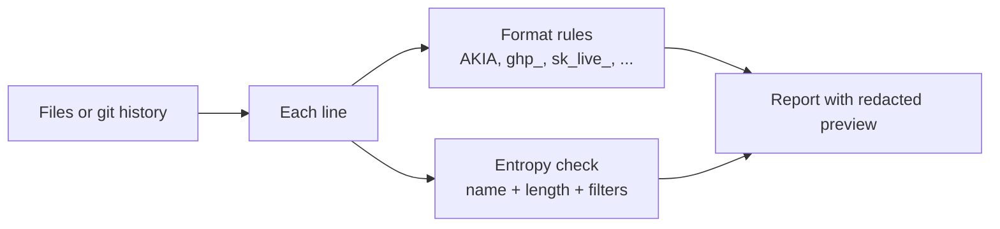

# secret-sentry: static secret scanner for source code and git history

A detector for hardcoded credentials left in source code - the kind of
mistake that leaks AWS keys, GitHub tokens, and database passwords onto
GitHub every day. Built as a companion to
[sqli-guard](https://github.com/mohamedelhadi7/sqli-guard) (my static
vulnerability checker): same idea - catch a specific, well-understood
class of security mistake before it ships - applied to secret leakage
instead of injection bugs.

It is a detector, not an exploitation tool: it never uses a secret it
finds, never contacts the service the key belongs to, and never touches a
live target. It reads text and reports where a credential is, with a
redacted preview, and tells you to rotate it.

**Full write-up:** [docs/REPORT.md](docs/REPORT.md) covers the design,
evaluation, results and limitations.

## How it works

Two layers of detection, run on every line of every scanned file:

1. **Format-specific regexes** for real-world secret shapes: AWS access
   keys and secret keys, GitHub tokens (classic and fine-grained), Slack
   bot tokens and webhook URLs, Google API keys, Stripe live/test keys,
   Twilio API keys, JWTs, and PEM private-key blocks. A format-specific
   prefix (`AKIA`, `ghp_`, `sk_live_`, `-----BEGIN...PRIVATE KEY-----`) is
   a much stronger signal than "this looks random", so these rules carry
   the bulk of the detection and let the tool name exactly what kind of
   credential it found.
2. **A generic entropy fallback** for everything else: a
   `name = "value"` assignment where the variable name hints at a
   credential (`key`, `token`, `secret`, `password`, ...) and the value's
   Shannon entropy is high enough that it's unlikely to be an English
   word, a placeholder, or a short code. This is deliberately the weaker,
   catch-all layer - it's what a format-specific rule can't cover, not the
   primary line of defense.

A placeholder list (`example`, `changeme`, `your_api_key`, `sample`, ...)
suppresses both layers so obvious non-secrets in `.env.example`-style
files don't get flagged. `.env.example` / `.env.sample` / `.env.template`
files are skipped entirely.

Two scan modes:
- **Working tree** (`python scanner.py <path>`) - every text file under a
  path, skipping binaries, `.git`, `node_modules`, build output, etc.
- **Git history** (`python scanner.py <path> --history`) - every *added*
  line across the full `git log -p`, so a secret that was committed and
  later deleted is still caught (deleting the line doesn't remove it from
  history - only rewriting history does).

## Quick start
    pip install pytest
    python samples/build_vulnerable.py     # builds a fake-secrets file in /tmp and scans it (9 findings)
    python scanner.py samples/fixed.py     # flags nothing
    python scanner.py . --history          # scan a repo's working tree + full git history
    python -m pytest tests                 # 2 tests
    python eval/benchmark.py               # 39-example, 8-category benchmark

## Why the test secrets are hex-encoded
A secret scanner needs realistic test secrets, but a public repo should
never contain secret-shaped text: GitHub's own push protection blocked the
first push of this project because of the (fake) AWS and Slack keys in the
fixtures. So the fake secrets are stored hex-encoded in
`samples/fragments.py` and `eval/benchmark_corpus.py`, and only assembled
in memory when a test, the demo, or the benchmark runs. The result: this
repo scans clean with its own tool, and CI checks that on every push
(`python scanner.py . --history`).

## Results

### Benchmark (`eval/benchmark.py`)
39 hand-written examples (`eval/benchmark_corpus.py`): 18 vulnerable
across 8 categories, 21 safe (including false-positive bait: placeholder
passwords, version strings, UUIDs, a Stripe-style price ID, a GitHub repo
URL, env-var lookups).

| Category | Vulnerable examples | Recall | False positives |
|---|---|---|---|
| aws | 3 | 3/3 = 100% | 0 |
| github | 3 | 3/3 = 100% | 0 |
| slack | 2 | 2/2 = 100% | 0 |
| google | 1 | 1/1 = 100% | 0 |
| stripe | 2 | 2/2 = 100% | 0 |
| jwt | 1 | 1/1 = 100% | 0 |
| private_key | 2 | 2/2 = 100% | 0 |
| generic | 4 | 4/4 = 100% | 0 |

Full table in `eval/benchmark_report.md` (regenerate with
`python eval/benchmark.py`).

**Important - the same honesty caveat as sqli-guard:** I wrote both the
scanner and this corpus, so 100% here is not evidence it generalizes to
real, unseen code - it only shows the detectors do what I designed them
to do and the corpus doesn't trip them up. There is no independently
collected held-out set for this project yet (sqli-guard's held-out set
for its runtime detector, assembled from public references and never
tuned against, is the model to follow - see that project's README for
what that gap in evidence actually looks like in practice). Building one
here is the obvious next step before trusting this number for anything
beyond "the eight detectors work as intended."

## Known limits
- The entropy fallback only looks at `name = "value"` assignments on a
  single line; a secret built across multiple lines, passed as a
  positional argument, or stored in a data structure (`{"key": "..."}`)
  without a matching variable name is not caught by that layer.
- Format-specific regexes match on shape, not validity: a string that
  happens to start with `AKIA` and has the right length is flagged even
  if it isn't a real, active AWS key (and conversely, a provider that
  changes its key format silently stops being caught until the regex is
  updated).
- No entropy analysis is run on binary or non-UTF8 files; they're skipped
  outright.
- Git history scanning reads `git log -p` over the whole repo, which
  does not scale well to very large histories - it's fine for a typical
  project repo, not for scanning monorepos with decades of history.
- Secrets split across string concatenation (`"AKIA" + "QZRM..."`) are not
  reconstructed and are missed.

## Ideas / next steps
- Build an independently-collected held-out set (real, redacted leaked
  secrets from public breach write-ups / GitHub security advisories)
  instead of self-authored examples.
- Add a pre-commit hook mode so secrets are caught before they're
  committed, not just after.
- Compare against an existing tool (gitleaks, trufflehog, detect-secrets)
  on the same corpus.
- Validate a subset of findings against provider-specific checksum
  formats (e.g. AWS access keys have a checksum you can verify without
  calling AWS) to cut false positives further without an API call.

Educational / defensive use only. Run this against code you own or have
permission to scan.
