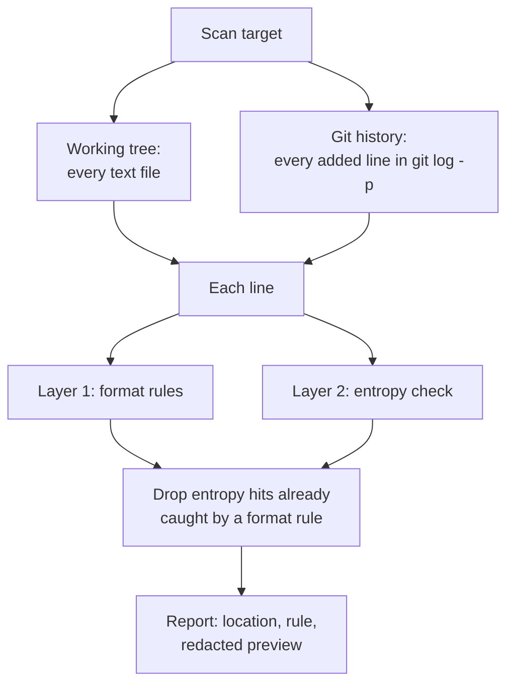

# secret-sentry: technical report

Mohamed Hedi Mahroug · SPbSUT, 10.03.01 Information Security · 2026

## 1. Summary

secret-sentry finds hardcoded credentials (cloud keys, API tokens, private
keys, passwords) in source code and in a repository's git history. It
reports where each one is, with only a redacted preview, so the owner can
rotate it. It never uses a credential it finds and never contacts the
service the credential belongs to.

| Item | Result |
|---|---|
| Benchmark (39 hand-written lines, 8 categories) | 18/18 secrets caught, 0/21 safe lines flagged |
| Self-scan in CI (working tree + full history) | no findings |
| Test suite | 2 tests, run in CI on every push |

The benchmark was written by the author of the tool, so it is a check that
the rules work as designed, not a measure of real-world accuracy (section 5).

## 2. Problem

Credentials pasted into code to "get it working" end up in commits. Once a
commit is pushed to a public repository, automated scanners can find the
key quickly. Deleting the line in a later commit does not help: the old
commit is still in the history and anyone with the repository can read it.
The only real fix for a leaked credential is to revoke it and issue a new
one. A scanner is useful twice: before a push, to stop the leak, and after,
to find what is already in history.

## 3. Design



### 3.1 Layer 1: format rules

Many providers give credentials a fixed prefix and length. One regular
expression per format covers AWS access keys and secret keys, GitHub
classic and fine-grained tokens, Slack bot tokens and webhook URLs, Google
API keys, Stripe live and test keys, Twilio API keys, JWTs and PEM
private-key blocks, plus a rule for `api_key` / `secret_key` / `password`
style assignments with a long value. A prefix match is strong evidence, and
it tells the user exactly which kind of credential leaked.

### 3.2 Layer 2: entropy check

Credentials with no known format are caught by a fallback. For each
`name = "value"` assignment it computes the Shannon entropy of the value,

H = −Σ p(c) · log₂ p(c)

where p(c) is the share of the string made up by character c. Natural
words repeat letters and score low (`password` = 2.75 bits per character);
randomly generated keys use many different characters and score high (a
33-character random key ≈ 4.98).

High entropy alone would flag IDs, hashes and UUIDs, so a value is reported
only if all of these hold:

| Filter | Reason |
|---|---|
| Variable name contains `key`, `token`, `secret`, `password`, `pwd`, `credential` or `auth` | ties the value to a credential |
| Value is at least 16 characters | short values are rarely keys |
| Value is not a known placeholder (`changeme`, `example`, `your_api_key`, ...) | skips documentation and templates |
| No spaces, only key-like characters | skips sentences, paths, version strings |
| Entropy ≥ 3.5 bits per character | separates random strings from words |

### 3.3 Reporting

Findings are grouped by category. Only the first and last four characters
of each secret are printed, so the report can be shared in a ticket or a CI
log without leaking the key again. When the same value matches a format
rule and the entropy check, it is reported once, under the format rule.

### 3.4 Keeping the repository itself clean

The first push of this project was blocked by GitHub push protection: the
fake test keys had the exact shape of real AWS and Slack credentials. The
fix was to store every test secret hex-encoded (`samples/fragments.py`,
`eval/benchmark_corpus.py`) and decode it only in memory when a test,
demo or benchmark runs. The repository now contains no secret-shaped text,
and CI enforces that by running `python scanner.py . --history` on every
push.

## 4. Implementation notes

- Python standard library only.
- Skips binary files, files over 2 MB, and directories such as `.git`,
  `node_modules` and build output. `.env.example`-style templates are
  skipped entirely.
- History mode runs `git log -p --all --unified=0` and scans only added
  lines, labelling each finding with the commit and file.

## 5. Evaluation

### 5.1 Method

`eval/benchmark_corpus.py` holds 39 labelled lines: 18 containing a fake
secret, spread over 8 categories, and 21 safe lines chosen to look
suspicious (an AWS region, a GitHub repository URL, a Stripe price ID, a
short JWT-like string, public-key and certificate headers, a placeholder
password, an environment-variable lookup, a UUID, a version string, a
file path). `eval/benchmark.py` scans each line and reports recall and false
positives per category.

### 5.2 Results

| Category | Secrets | Caught | False positives |
|---|---|---|---|
| aws | 3 | 3 | 0 |
| github | 3 | 3 | 0 |
| slack | 2 | 2 | 0 |
| google | 1 | 1 | 0 |
| stripe | 2 | 2 | 0 |
| jwt | 1 | 1 | 0 |
| private_key | 2 | 2 | 0 |
| generic | 4 | 4 | 0 |

The first benchmark run scored 15/18. The three misses were test values
that did not match the real formats (wrong length, or a symbol outside the
allowed character set). They were corrected in the corpus rather than by
loosening the rules.

### 5.3 Interpretation

The corpus is small and was written by the author of the rules, so 100%
shows that the detectors behave as designed and protects against
regressions. It says nothing reliable about real code. A fair measurement
needs an independently collected held-out set, which sqli-guard already
uses for its runtime detector.

## 6. Limitations

- The entropy check only sees single-line `name = "value"` assignments.
  Values passed as arguments, stored in dictionaries without a matching
  name, split across lines or concatenated are missed.
- Format rules check shape, not validity: a string with the right shape is
  flagged even if it is not a live key, and a provider that changes its
  format stops being caught until the rule is updated.
- Name-based filters can be fooled by unusual variable names.
- History mode reads the whole `git log -p`, which is fine for normal
  project repositories but slow on very large histories.

## 7. Next steps

1. An independently collected held-out set.
2. A pre-commit hook mode, to stop a secret before it is committed.
3. A side-by-side comparison with gitleaks, TruffleHog and detect-secrets
   on the same corpus.
4. Offline checksum validation for formats that support it, to reduce false
   positives without contacting any provider.

## 8. Reproducing the results

```
pip install pytest
python -m pytest tests                # unit tests
python eval/benchmark.py              # benchmark table
python samples/build_vulnerable.py    # demo: builds a fake-secrets file in /tmp and scans it
python scanner.py . --history         # scan this repository and its history
```

Use only on code you own or are permitted to scan.
